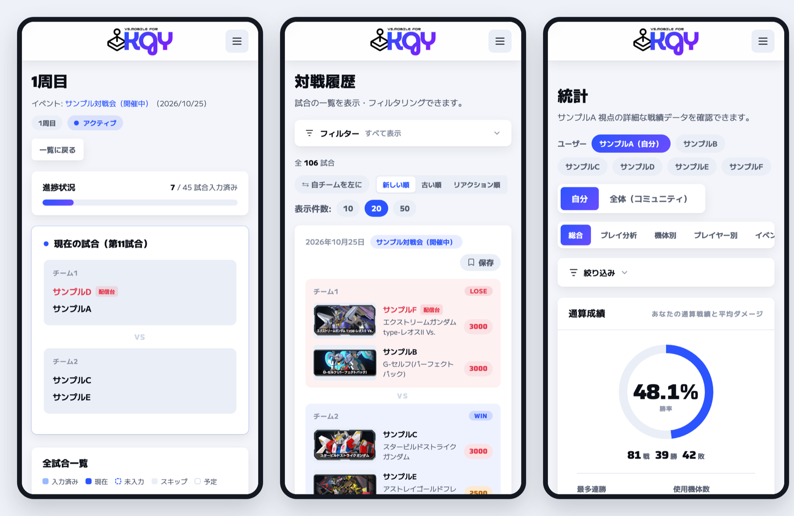

# VS.Mobile for KGY

「機動戦士ガンダム エクストリームバーサス2 インフィニットブースト」の対戦会を支える Web アプリです。
ゲームセンターの 4 台を貸し切り、4〜8 人の仲間内で対戦する規模を前提にしています。対戦順の作成と進行、試合結果の記録、そのあとの戦績の分析までを、参加者それぞれのスマホで行います。



## このアプリのいいところ

- **対戦順を考えなくていい。** 当日の参加者を選ぶと、その日の全試合の組み合わせができます。同じ相方・同じ相手が続かないように、配信台に座る回数も人によって偏らないように組まれます
- **出番を待つあいだ、台のそばにいなくていい。** いま何試合目で、次に誰が戦うかを、全員が自分のスマホで見られます。自分の出番が 2 試合前に迫ると、プッシュ通知で知らせます
- **公式の VS.モバイルより、いろいろな角度から戦績を見られる。** 試合のデータは公式の VS.モバイルに記録されたものを使い、公式では集計されていない指標まで見える形にします。EX バーストを使った回数、2 落ちまでの時間、相方ごと・相手ごとの勝率などを、個人・機体・イベントの単位で見比べられます
  - VS.モバイルのデータは、参加者それぞれが自分のスマホから送ります。送る操作はブックマークレット（ブラウザのブックマークとして登録しておく小さなプログラム）で、VS.モバイルを開いた状態でそれをタップすると、その日の自分の試合の結果だけがアプリに送られます。ログイン情報（Cookie やパスワード）を誰かに預ける必要はありません
- **配信アーカイブで自分の試合をすぐ探せる。** 配信アーカイブのどこから何試合目が始まるかを試合の時刻から割り出し、各試合にその場面へのリンクが付きます
- **連絡を忘れない。** 対戦会の 1 週間前と前日のリマインド、準備のお願い、統計の登録が終わった連絡が、Discord に自動で投稿されます
- **機体の攻略 Wiki にすぐ飛べる。** 試合の記録や統計に出てくる機体名から、その機体の攻略 Wiki のページを開けます

## 開発

Ruby 4.0.9 / Rails 8.1 / PostgreSQL / Hotwire / Tailwind CSS

```bash
bundle install
docker compose up -d   # PostgreSQL（ポート 5433）
bin/setup              # DB とサンプルデータを作り、開発サーバーを起動
```

2 回目以降は `bin/dev` で起動します。テストは `bin/rails test`、CI と同じ一式は `bin/ci` です。

サンプルデータには `sample_a` 〜 `sample_f` と管理者 `admin` でログインできます（パスワードはどちらも `password`）。
作り直しや Discord の投稿のローカルでの試し方は [docs/development.md](docs/development.md) にあります。

## 運用

- [デプロイ](docs/deploy.md): main へのマージで GitHub Actions が Kamal を使ってデプロイします
- [リリース](docs/release.md): 告知文を置くと起動時にアプリ内と Discord へ自動で告知します。タグと GitHub Release も自動です
- [機体マスタ](docs/mobile-suits.md): Wiki の変更を毎日確認し、更新の PR を作ります

## ライセンス

[MIT License](LICENSE)
